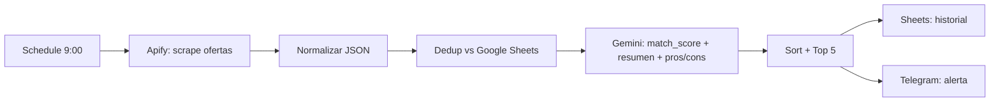

# JobRadar AI

> Agente personal que busca, filtra con IA y notifica por Telegram las
> mejores ofertas de trabajo del día. Costo: **$0/mes**.


## Qué hace

Cada mañana un pipeline en **n8n** dispara un scraper de LinkedIn Jobs
(**Apify**), pasa cada oferta nueva por **Google Gemini** para calcular
un `match_score` contra mi perfil, guarda el historial en **Google
Sheets** y me manda por **Telegram** las mejores 5 ofertas del día.

## Arquitectura

Ver [docs/arquitectura.md](docs/arquitectura.md) (diagrama Mermaid +
decisiones de diseño).



## Stack

| Capa | Herramienta | Por qué |
|---|---|---|
| Orquestador | n8n (Docker local) | Workflows visuales exportables a JSON |
| Scraping | Apify (tier free $5/mes) | Actors mantenenidos de LinkedIn Jobs |
| IA | Gemini 2.5 Flash (free tier) | Salida JSON forzada, prompts estructurados |
| Persistencia | Google Sheets | Historial consultable, nodo nativo de n8n |
| Alertas | Telegram Bot | Gratis, sin límite de mensajes

## Estructura del repo

```
jobradar-ai/
├── docker-compose.yml      # n8n local en :5678
├── .env.example            # variables de entorno documentadas
├── workflow/               # workflows de n8n exportados (JSON)
├── profile/perfil.md       # perfil profesional (input del matching)
├── prompts/gemini-match.md # prompt system + esquema de salida
└── docs/
    ├── arquitectura.md     # diagrama + decisiones
    └── screenshots/        # capturas ( Sheets + Telegram)
```

## Setup

```bash
# 1. Clonar y configurar
git clone https://github.com/<user>/jobradar-ai.git
cd jobradar-ai
cp .env.example .env   # completar N8N_ENCRYPTION_KEY como mínimo

# 2. Levantar n8n
docker compose up -d
# → abrí http://localhost:5678 y creá el usuario del editor

# 3. Importar el workflow desde workflow/ y cargar credenciales:
#    - Apify API token     (Settings > Integrations en apify.com)
#    - Google AI Studio key (aistudio.google.com/apikey)
#    - Google Sheets OAuth (asistido por n8n)
#    - Telegram Bot token  (de @BotFather) + chat_id propio

# 4. Activar el Schedule Trigger. Listo.
```

## Detalle de cada etapa

- **Etapa 1 — Ingesta**: Schedule Trigger → HTTP a Apify
  (`run-sync-get-dataset-items` = un solo call que dispara el actor y
  devuelve los ítems) → Code node normaliza el output a un schema
  interno (`titulo`, `empresa`, `link`, `descripcion`).
- **Etapa 2 — Matching IA**: prompt estructurado en
  [prompts/gemini-match.md](prompts/gemini-match.md). Gemini responde
  un JSON exacto: `{match_score, resumen, pros, cons}`. Dedup previo en
  Sheets para no gastar llamadas en ofertas ya vistas.
- **Etapa 3 — Notificación**: Sort por score desc → Top 5 → si
  score ≥ 7, Append a Sheets + mensaje a Telegram.
- **Etapa 4 — Documentación**: este README, diagrama, capturas.

## Roadmap

- [ ] Etapa 1: actor de Apify elegido y workflow corriendo
- [ ] Etapa 2: matching con Gemini funcionando end-to-end
- [ ] Etapa 3: Sheets + Telegram en producción
- [ ] Etapa 4: capturas + diagrama final + demo GIF
