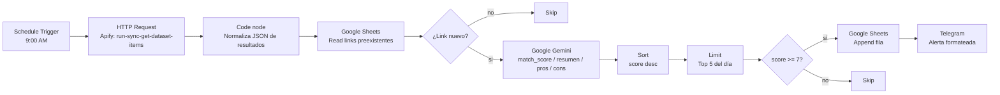

# Arquitectura

## Decisiones de diseño

| Decisión | Motivo |
|---|---|
| Dedup ANTES de la IA | Ahorra ~50% de llamadas a Gemini (las ofertas se repiten en feeds consecutivos) |
| Top 5 del día | La alerta en Telegram sigue siendo útil y no se convierte en ruido |
| `run-sync-get-dataset-items` de Apify | Un solo HTTP call: dispara el actor y trae el dataset cuando termina |
| `response_mime_type: application/json` en Gemini | Evita parsear markdown y destraba bugs del workflow |
| Score 0 si la respuesta es inválida | El errors-handling nunca corta el workflow entero |
